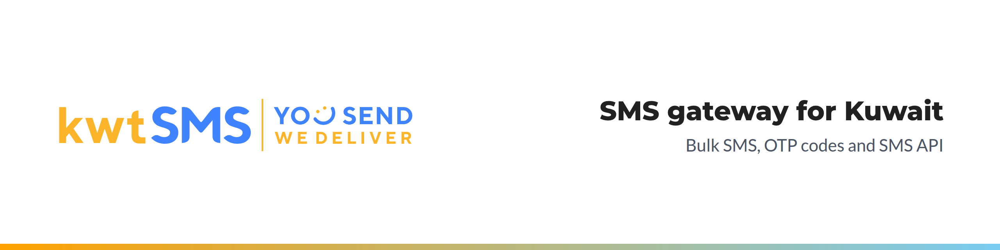

<picture>
  <source media="(prefers-color-scheme: dark)" srcset=".github/assets/readme-header-dark.png">
  
</picture>

# kwtSMS for Keycloak

[](https://www.keycloak.org)
[](https://adoptium.net)
[](https://opensource.org/license/mit)

Add an SMS code to your Keycloak logins: after the password, Keycloak sends a one-time code by SMS through kwtSMS,
the Kuwaiti SMS gateway, and the user types it in. Free and open source.

kwtSMS delivers to Zain, Ooredoo, stc and Virgin in Kuwait and to more than 200 countries, with your own Sender ID,
free API testing and credits that do not expire.

## Features

**Login step**
- "kwtSMS SMS code" step for any browser flow, usually right after the Username Password Form.
- The code goes to the mobile number stored on the user (attribute `phone_number`, or any attribute you choose,
  for example `mobile` from LDAP or Active Directory).
- Code page with a Resend code button, in English and Arabic.
- SMS text in English or Arabic, chosen by the user's language, with `{code}`, `{ttl_minutes}` and `{realm}`.

**Security**
- Random codes, kept only as a hash, single use, with a lifetime you set.
- Limits: wrong-code attempts per login, resend wait, SMS per user per hour, SMS per IP address per hour, SMS per
  realm per hour, allowed country codes. The hourly counts are kept on the Keycloak server (shared by all nodes of a cluster), not on the
  user, so they also work for LDAP and other read-only user stores and users cannot reset them.
- One general message to the user for every sending problem; the reason is written to the server log and to
  Keycloak events, with the mobile number masked.
- The kwtSMS API password is set on the server, never in the admin console.

## Requirements

- Keycloak 26.x (built and tested against 26.8.2), Java 17 or later.
- A kwtSMS account (free test account, no papers): https://www.kwtsms.com/cportal/signup/
- A Transactional Sender ID for login codes (promotional Sender IDs are filtered for numbers on the
  do-not-disturb list).

## Installation

1. Download `kwtsms-keycloak-<version>.jar` from the releases page.
2. Copy it to the `providers/` folder of your Keycloak.
3. Run `bin/kc.sh build`, then restart Keycloak (`bin/kc.sh start`).

The jar is a single file: it carries everything it needs and nothing that Keycloak already has.

## Setup

### 1. API username and password (on the server)

Set the API username and password of your kwtSMS account (not your mobile number) as Keycloak server options.
Pick one of these ways:

```bash
# Command line
bin/kc.sh start \
  --spi-authenticator--kwtsms-sms-code--username=YOUR_API_USERNAME \
  --spi-authenticator--kwtsms-sms-code--password=YOUR_API_PASSWORD
```

```bash
# Environment variables (containers)
KC_SPI_AUTHENTICATOR__KWTSMS_SMS_CODE__USERNAME=YOUR_API_USERNAME
KC_SPI_AUTHENTICATOR__KWTSMS_SMS_CODE__PASSWORD=YOUR_API_PASSWORD
```

```properties
# conf/keycloak.conf
spi-authenticator--kwtsms-sms-code--username=YOUR_API_USERNAME
spi-authenticator--kwtsms-sms-code--password=YOUR_API_PASSWORD
```

If they are missing, the server log says so at start and the step refuses every login it is part of.

Prefer the environment variables or `keycloak.conf` (readable only by the Keycloak user): a password on the command
line can be seen in the process list. Use the same values on every node of a cluster.

### 2. The phone number of each user

Each user needs a mobile number in a user attribute (default `phone_number`). In Keycloak 26 add the attribute in
**Realm settings > User profile** (or map it from LDAP), then fill it in for your users. Local numbers of 8 digits
or fewer get the default country code (`965`); numbers with `+` or `00` are used as they are.

**Important: only administrators may change the phone number.** The code goes to whatever number is stored, so a
user (or anyone who has their password) who can edit it can send the code to another phone. In
**Realm settings > User profile > Attributes**, open the phone attribute and under **Permission** set
**Who can edit** to **Admin** only (users may stay in **Who can view**). Keep **Realm settings > General >
Unmanaged Attributes** on **Disabled** (the default) or **Admin can edit**, never **Enabled**, and do not put the
phone attribute on the registration form. For LDAP, map it read-only from the directory.

### 3. The login flow

1. Go to **Authentication**, open the **browser** flow and choose **Duplicate**.
2. In the copy, find the step group that holds **Username Password Form** and click **Add step** there.
3. Choose **kwtSMS SMS code**, place it after **Username Password Form** and set it to **Required** (the step
   offers only Required and Disabled). It must come after the password step: placed first, it has no user yet and
   every login stops with "Invalid username or password" before the password page shows.
4. Click the gear icon of the new step and fill in the settings (below). The Sender ID is required.
5. Use **Bind flow** on your copy and choose **Browser flow**.

The extension never writes the kwtSMS request log of the Java library (that log would hold the login code and
the phone number in plain text); keep it that way if you build your own version.

### 4. Settings

| Setting | Default | Notes |
|---|---|---|
| Sender ID | (empty) | Required. Your Transactional Sender ID. |
| Phone attribute | `phone_number` | User attribute with the mobile number. |
| Default country code | `965` | For local numbers. |
| Allowed country codes | `965` | Comma separated, for example `965, 966`. There is no "all countries" value. |
| Code length | 6 | 4 to 10 digits. |
| Code lifetime (seconds) | 300 | 60 to 3600. |
| Resend wait (seconds) | 180 | 30 to 3600. |
| Max attempts | 5 | Wrong codes per login before the login fails. |
| Max SMS per user per hour | 5 | 1 to 50, per clock hour. |
| Max SMS per IP per hour | 100 | 1 to 10000, all users on one client IP address together, per clock hour. IPv6 clients count by their /64 network. See [Mobile networks (CGNAT)](#mobile-networks-cgnat). |
| Max SMS per realm per hour | 200 | 1 to 10000, all users together, per clock hour. |
| Test mode | off | Messages are queued, not delivered. |
| SMS template (English) | `Your {realm} SMS code is {code}. It expires in {ttl_minutes} minutes.` | |
| SMS template (Arabic) | `رمز التحقق لدخول {realm}: {code}، صالح لمدة {ttl_minutes} دقائق.` | Used for users whose language is Arabic. |

### Limits and stolen passwords

The SMS is sent after the password is accepted, so anyone who has a user's password can make Keycloak send that
user a code. The limits keep this small:

- **Per user:** after the hourly limit the user sees the general message and gets no more codes until the clock
  hour ends; they are never held back longer than that, and these stops do not count as failed logins.
- **Per IP address:** one client address gets at most this many codes per clock hour, for all users together, so
  one attacker with many stolen passwords cannot use up the realm limit. IPv6 addresses count by their /64
  network, because one site can switch between the addresses inside it. If many real users share one address,
  raise it (see [Mobile networks (CGNAT)](#mobile-networks-cgnat)). Behind a reverse proxy, set up proxy headers
  first (see [Behind a reverse proxy](#behind-a-reverse-proxy-or-load-balancer)).
- **Per realm:** when the realm limit is reached nobody gets a code until the hour ends. Set it a little above
  your busiest real hour, and alert on this server log line (ERROR level, always the same text):

  ```
  kwtSMS SMS code: realm SMS ceiling reached
  ```
- **Refused sends** (a kwtSMS error reply) use no slot of any limit. A timeout or lost connection still counts, because the SMS may have been delivered.
  Reloading the code page never sends another SMS while the code is valid or the resend wait is running, and a
  failed send starts the resend wait too.
- **Wrong codes** count as failed logins. Turn on **Realm settings > Security Defenses > Brute Force Detection**
  so that password guessing and code guessing lock the account the way you choose.

Turn on brute force detection in every realm that uses this step.

### Mobile networks (CGNAT)

Mobile carriers put many customers behind one public address (carrier-grade NAT), so on mobile data many users
share one IP limit. For a public consumer realm raise Max SMS per IP per hour, for example to 200 to 500, and rely
on the per-user limit and the realm limit. For staff or office realms a lower value is fine.

### Behind a reverse proxy or load balancer

Keycloak sees the proxy's address, so every user would share one IP limit. If proxy headers are not set up, the
whole realm shares one per-IP bucket and the per-IP limit stops everyone at once. Start Keycloak with the `proxy-headers` option (`forwarded` or `xforwarded`, whichever your proxy sets) and
`proxy-trusted-addresses` set to your proxy's addresses, and make the proxy overwrite these headers, not append to
them. See [Configuring a reverse proxy](https://www.keycloak.org/server/reverseproxy).

### Test mode

Turn test mode on to check your setup without delivering messages. Test messages are not delivered, so nobody can
log in through the step while it is on. Their credits are held until you delete them from the Sending Queue in your
kwtSMS account. Turn test mode off before real users log in.

## Arabic

The code page and its messages come in English and Arabic; Keycloak shows Arabic right to left when the user's
language is Arabic. Arabic SMS are sent as Unicode: one SMS page holds 70 Arabic characters, against 160 English
ones. Codes typed with Arabic digits are accepted.

## FAQ

**Which username do I use?** The API username and password of your kwtSMS account, not your mobile number.

**Why do test messages not arrive?** Test mode queues messages without delivering them. Turn it off in the step
settings.

**What is a Sender ID?** The name shown as the sender on the phone. See the
[Sender ID help](https://www.kwtsms.com/sender-id-help.html).

**A user says the code never came.** The user sees one general message on purpose. Look in the Keycloak server log
for `kwtSMS SMS code` and in the login events for the `kwtsms_reason` and `kwtsms_error` details: no phone number,
a number outside the allowed country codes, the hourly limit for the user (`user_hourly_cap`), the IP address
(`ip_hourly_cap`) or the realm (`realm_hourly_cap`), or a kwtSMS error code.

## Changelog

See [CHANGELOG.md](CHANGELOG.md).

## Support

Help: https://www.kwtsms.com/support.html | FAQ: https://www.kwtsms.com/faq/ |
API: [developers](https://www.kwtsms.com/developers.html), [API reference](https://www.kwtsms.com/api-documentation.html)

## License

MIT, (c) kwtSMS (BoxLink Center). Includes the kwtSMS Java client library (MIT, (c) kwtSMS).
